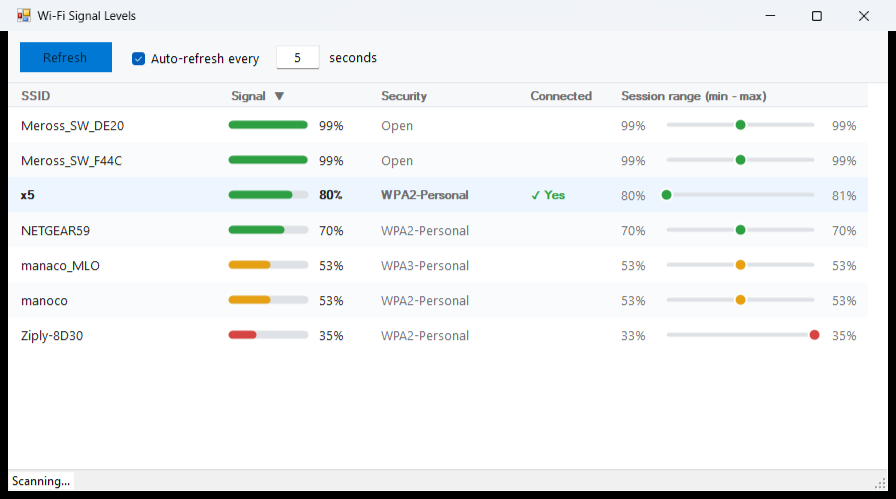

# WifiSigLevel

A small Windows desktop app that lists nearby Wi-Fi networks and shows how strong each signal is, live.



## Features

- Lists every visible SSID with a color-coded signal bar (green ≥ 70%, amber ≥ 40%, red below)
- Shows the security type and highlights the network you're connected to
- **Session range:** the lowest and highest level seen for each SSID since the app started, with a dot marking where the current level sits in that range
- Auto-refresh with a configurable interval (default 5 seconds), plus a manual Refresh button
- Click any column header to sort

Ranges are kept in memory only; restarting the app starts fresh.

## Requirements

- Windows 10/11 with a Wi-Fi adapter
- .NET Framework 4 (included with Windows) — no extra installs

## Build and run

```powershell
.\build.ps1          # compiles WifiSigLevel.cs with the built-in csc.exe
.\WifiSigLevel.exe
```

A prebuilt `WifiSigLevel.exe` is also checked in.

To run the self-tests (also prints a live scan to the console):

```powershell
.\WifiSigLevel.exe --selftest
```

## How it works

The app calls the Windows Native Wifi API (`wlanapi.dll`) to trigger a scan on each adapter and read the available network list. Duplicate SSIDs (e.g. multiple access points) are collapsed to the strongest signal.
